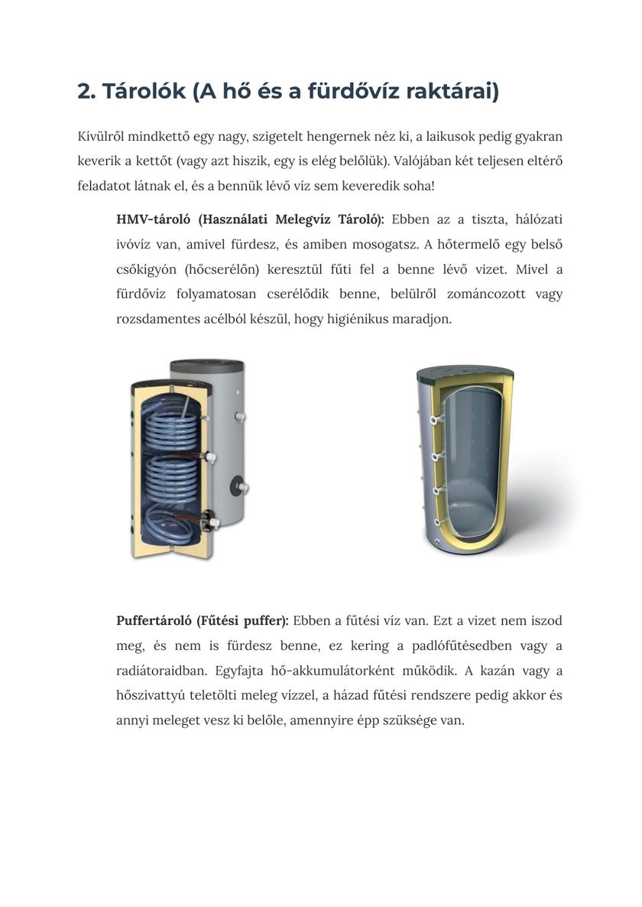
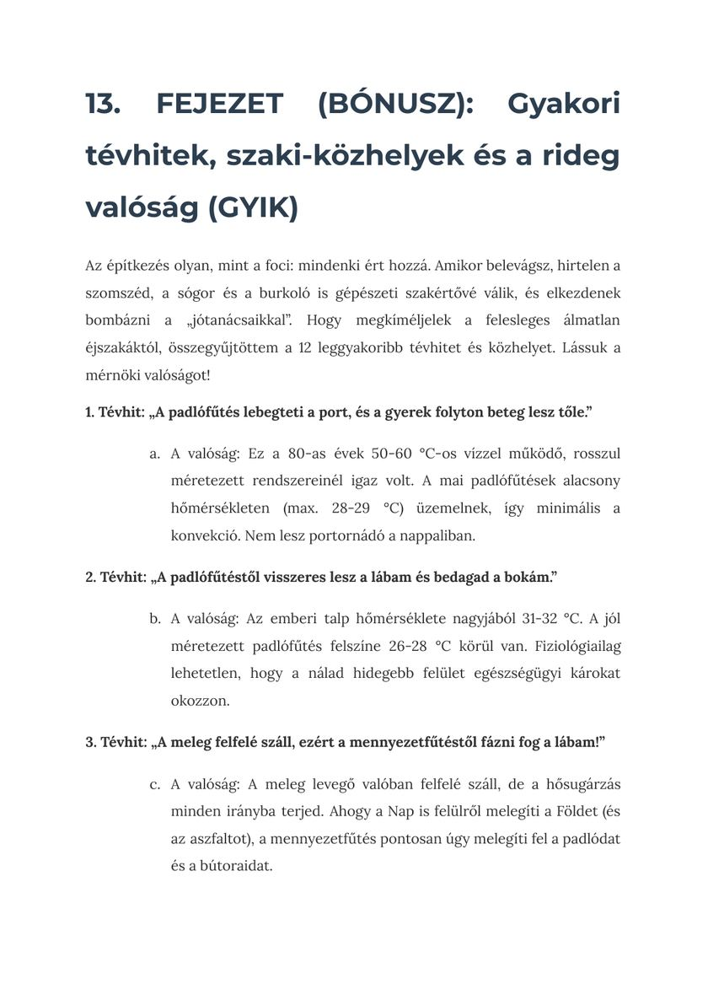

Az építkezőktől újra és újra ugyanazokat a kérdéseket hallom, és sajnos ugyanazokat a drága hibákat látom. Egy túlméretezett hőszivattyút, amit „biztos, ami biztos” alapon vettek meg. Egy kispórolt iszapleválasztót, ami miatt pár év alatt tönkrement a gép. Egy padló alá rosszul vezetett csövet, amit már csak vésővel lehet javítani. Ezek a döntések nem a beköltözés után dőlnek el, hanem jóval korábban, amikor a tulajdonos még nem tudja, mit kérdezzen. Ezért írtam meg az **Épületgépészeti ABC** című könyvet.

## Kinek szól a könyv?

Laikusoknak: családi házat építőknek és felújítóknak, akik nem értenek a gépészethez, de nem szeretnének fogalmatlanul belevágni. Nem szakembereknek és nem tervezőknek készült, ezért nincs benne képletrengeteg és szakmai zsargon. Ahol mégis kell egy-egy szakkifejezés, ott hétköznapi nyelven elmagyarázom.

A könyv kizárólag családi házakkal, lakossági méretekkel foglalkozik. Társasházi vagy ipari rendszerekről nem szól.

## Mit tud meg belőle?

A célom az, hogy a kivitelezőkkel és a szakikkal egy nyelvet beszéljen: tudja, mit kérjen, mit kérdezzen, és hogyan hasonlítsa össze az árajánlatokat. Néhány téma a könyvből:

- **A jó gépészet alapjai:** mire való a mérnöki terv, és miért nem elég a „szaki majd megoldja”.
- **Hőveszteség és méretezés:** miért hibás a „100 m²-re 10 kW” ökölszabály, és miért nem alkalmas az energetikai tanúsítvány a fűtés méretezésére.
- **Árajánlatok:** hogyan kérjen árazatlan költségvetés alapján összehasonlítható ajánlatokat.
- **A gépészeti helyiség:** mi a különbség a puffertároló és a HMV-tároló között, mire jó a hidraulikus váltó, az iszap- és a mikrobuborék-leválasztó.
- **Hőtermelők és hőleadók:** hőszivattyú, gázkazán, szilárd tüzelés, padló-, fal- és mennyezetfűtés, hűtés.
- **Szellőzés, víz, csatorna:** gépi szellőztetés hővisszanyeréssel, vízellátás, szennyvíz és esővíz.
- **Megvalósítás:** a kivitelezés 7 lépése, korrekt fizetési ütemezés és átadás-átvételi ellenőrzőlista.

## Mennyit spórolhat vele?

A könyvben valós példákon mutatom meg, mibe kerülnek a tipikus hibák:

- Ha 6 kW helyett 12 kW-os hőszivattyú kerül a házba, az **1–1,5 millió forint** felesleges kiadás, ráadásul a gép rosszabb hatásfokkal üzemel és hamarabb elhasználódik.
- Egy kispórolt iszap- és mikrobuborék-leválasztó miatt egy **2–3 millió forintos** hőszivattyú pár éven belül tönkremehet.
- Az alulméretezett hőszivattyú a leghidegebb napokon elektromos fűtőpatronnal fűt. Ez 1 kWh áramból csak 1 kWh hőt ad, míg a hőszivattyú 3–4 kWh-t, így a januári villanyszámla elszáll.

Ezekhez képest egyetlen jó kérdés az árajánlatkérésnél is többszörösen megtérül.

## A 12 legveszélyesebb szaki-tévhit

A bónuszfejezetben összegyűjtöttem azokat a mondatokat, amelyeket szinte minden építkező hall: „a padlófűtéstől bedagad a láb”, „a meleg felfelé száll, ezért a mennyezetfűtéstől fázni fog a lába”, „a gép legyen inkább nagyobb”. Mindegyik mellé leírtam, mi a valóság, és miért.

## Helyettesíti a gépészeti tervezőt?

Nem, és nem is ez a célja. A könyv abban segít, hogy felkészülten üljön le a tervezővel és a kivitelezővel, és értse, mit miért javasolnak. A saját házára szabott méretezést és rendszert továbbra is egy épületgépészeti terv adja meg. Erről bővebben a [Mit tartalmaz egy épületgépészeti terv?](/blog/mit-tartalmaz-egy-epuletgepeszeti-terv/) című cikkben írtam.

A könyvet Szabó Ferenc okleveles létesítménymérnök (Gépész Stúdió Kft.) lektorálta szakmailag.

## Hol lehet megvenni?

Az Épületgépészeti ABC a **[gepeszabc.hu](https://gepeszabc.hu/)** oldalon vásárolható meg. Ott minden részletet megtalál a könyvről és a vásárlásról.

**[Megnézem a könyvet a gepeszabc.hu oldalon →](https://gepeszabc.hu/)**
