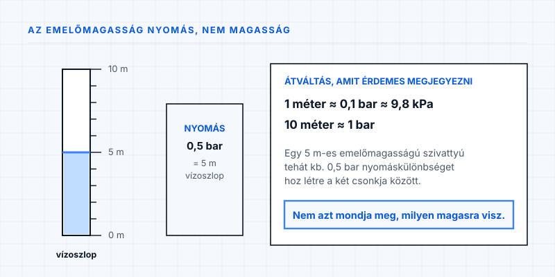
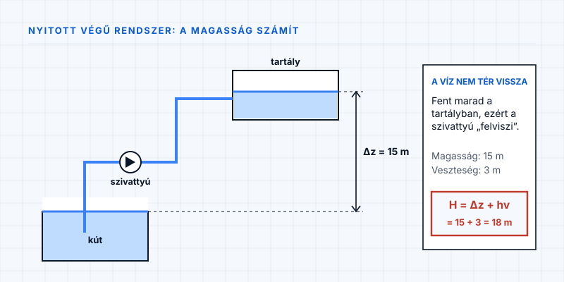
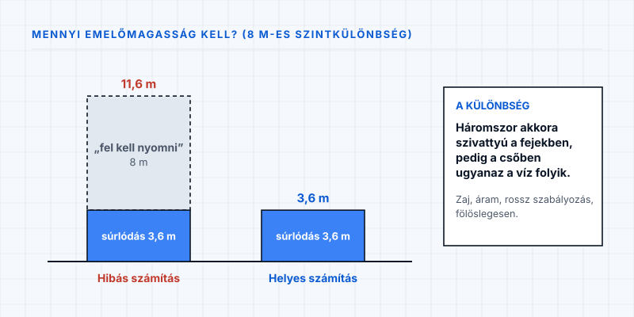
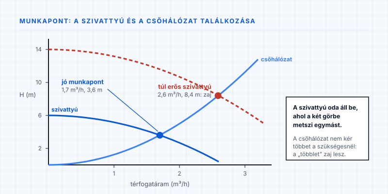

Ismerős a mondat? „Erősebb szivattyú kell, mert a gépészet a pincében van, a radiátor meg a tetőtérben, és fel kell nyomni oda a vizet.” Zárt fűtési körben ez **nem igaz**, és ha eszerint méretezel, a pénztárcád bánja. Nézzük meg a Bernoulli-egyenlettel, és húzzuk ki belőle a tagokat.

## Mit jelent az emelőmagasság?

A szivattyú adatlapján szereplő „H = 6 m” nem azt jelenti, hogy ilyen magasra viszi a vizet. Az emelőmagasság **nyomáskülönbség**, vízoszlop-méterben: $H = \frac{\Delta p}{\rho \cdot g}$. Megjegyezni elég ennyit: **1 m ≈ 0,1 bar**. A szivattyú tehát nem lift, hanem olyan, mint a biciklipumpa: nyomást ad.

*1. ábra – Az 5 m-es szivattyú kb. 0,5 bar nyomáskülönbséget hoz létre.*

## A Bernoulli-egyenlet

Két pont között (1: a szivattyú előtt, 2: később) a víz energiája nem vész el, csak átalakul. Nyomásformában:

$$
\Delta p_{sz} = (p_2 - p_1) + \rho g (h_2 - h_1) + \frac{\rho}{2}\,(v_2^2 - v_1^2) + \Delta p_{\text{ell}}
$$

- **$p_2 - p_1$:** a statikus nyomás változása;
- **$\rho g (h_2 - h_1)$:** a magasságkülönbség (helyzeti energia);
- **$\frac{\rho}{2}(v_2^2 - v_1^2)$:** a sebesség változása (mozgási energia);
- **$\Delta p_{\text{ell}}$:** az ellenállás, vagyis amit a cső „elvesz”:

$$
\Delta p_{\text{ell}} = \frac{\rho}{2}\,v^2 \left(\sum \zeta + \lambda \frac{L}{d}\right)
$$

Itt $\sum \zeta$ az idomok és szerelvények, $\lambda \frac{L}{d}$ a csősúrlódás (hosszú, vékony cső: nagy veszteség). Ha mindent a $\rho g$-vel osztunk, méterben kapjuk: **$H = \Delta h + h_v$** (és a nyomás- és sebességtagok, ha vannak).

## 1. eset: nyitott végű rendszer (kút, ciszterna)

A kútból 15 m-rel magasabb tartályba pumpálunk. Mindkét víztükörre légköri nyomás hat, így $p_1 = p_2$, a nagy felszínen $v \approx 0$.

- ✂ nyomástag: kiesik;
- ✂ sebességtag: kiesik;
- ✔ magasságtag: **marad**.

$\Delta p_{sz} = \rho g \Delta h + \Delta p_{\text{ell}}$, vagyis ha a veszteség 3 m: $H = 15 + 3 = \mathbf{18}$ m. Itt a magasság számít, mert **a víz nem tér vissza**: fent marad.

**De szívni sem lehet a végtelenségig.** A szívócsőben a vizet nem a szivattyú „húzza” fel, hanem a külső légnyomás tolja. A légnyomás legfeljebb kb. 10 m vízoszlopot tart el, ez az elméleti határ. Gyakorlatban a szívócső vesztesége, a víz gőznyomása és a szivattyú saját igénye (NPSH) miatt a felszíni szivattyú **legfeljebb kb. 6–7 m mélyről** szív, meleg víznél kevesebbről. Ennél mélyebb kútba merülő szivattyú kell, amely lent van, és nyomja a vizet. Túl nagy szívómagasságnál a víz a szivattyúban „felforr” (kavitáció), ami zajjal és gyors kopással jár. A **nyomóoldali** magasságot ezzel szemben a szivattyú emelőmagassága korlátozza.

*2. ábra – A víz fent marad, ezért a szintkülönbség is a szivattyú dolga.*

## 2. eset: zárt hurok (fűtés, hűtés)

A víz körbejár: **ugyanoda érkezik vissza**, ahonnan elindult. Legyen az 1. és a 2. pont ugyanaz a pont, egy körrel később:

- ✂ $p_2 = p_1$: a nyomástag kiesik;
- ✂ $v_2 = v_1$: a sebességtag kiesik;
- ✂ $h_2 = h_1$: **a magasságtag kiesik**.

$$
\Delta p_{sz} = \Delta p_{\text{ell}}
$$

A szivattyú **csak a súrlódást és az ellenállásokat fedezi**.  Pont úgy működik ez, mint egy ellensúlyos lift: amikor a kabin felfelé megy, a másik oldalon a lefelé süllyedő ellensúly segít neki. A motornak ezért nem kell az egész kabint megemelnie, csak mozgásban kell tartania a rendszert. Egy zárt fűtési körben a lefelé áramló víz maga az ellensúly – pontosan ezt mutatja a cikk tetején lévő ábra.

**Számpélda:** 8 m szintkülönbség, a legrosszabb kör ellenállása 35 kPa (≈ 3,6 m). Hibás gondolkodással $8 + 3{,}6 = 11{,}6$ m, helyesen $\mathbf{3{,}6}$ m.

*3. ábra – Háromszoros túlméretezés, egy félreértés miatt.*

> ► **Tipp:** A vitát egy kérdés eldönti: **„Hol folyik ki a víz a rendszerből?”** Ha sehol, mert körbejár, a magasság kiesik. A „nyitott tágulási tartályos” régi fűtés is zárt hurok.

## Hol számít mégis a magasság?

Nem a szivattyúnál, hanem a **statikus nyomásnál**: a töltőnyomásnál (kb. magasság/10 + 0,3–0,5 bar, a pontos értéket a tervezés adja) és a [tágulási tartály előnyomásánál](/blog/tagtartaly-meretezese/). Ezek beállítások, a szivattyú méretét nem érintik.

## Mi dönti el a szivattyú méretét?

A legrosszabb kör teljes ellenállása (cső, idomok, szelepek, padlófűtési hurok, kazán vagy hőszivattyú, puffer), és a szükséges vízmennyiség: $Q = \frac{P}{c \cdot \rho \cdot \Delta T}$. 10 kW és 5 K hőfoklépcső mellett ez kb. 1,7 m³/h. A szivattyú oda áll be, ahol a görbéje metszi a csőhálózatét: ez a **munkapont**.

*4. ábra – A túl erős szivattyú (piros) több vizet présel át, nagyobb nyomással: zaj és felesleges áram.*

> ► **Gyakori hiba:** a „biztos, ami biztos” alapon beépített nagyobb szivattyú zajt, magasabb áramszámlát és rosszabb szabályozást hoz. Kérdezd meg a szerelőt, melyik **munkapontra** számolt.

## Összefoglalva

- Az emelőmagasság nyomáskülönbség (1 m ≈ 0,1 bar), nem távolság.
- Nyitott végű rendszerben (kút, ciszterna) $H = \Delta h + h_v$.
- Zárt hurokban (fűtés, hűtés, cirkuláció) $H = h_v$, a magasság kiesik.

Hőszivattyúhoz [ez a cikk](/blog/hoszivattyu-tervezes-elott/) ad kapaszkodót, a részletekről az [Épületgépészeti ABC](/blog/epuletgepeszeti-abc-konyv/) szól. Ha tervezel, [kérj ajánlatot](/ajanlat/), és 24 órán belül megkapod PDF-ben.
