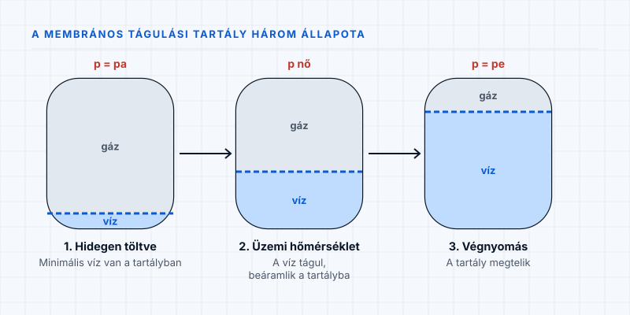
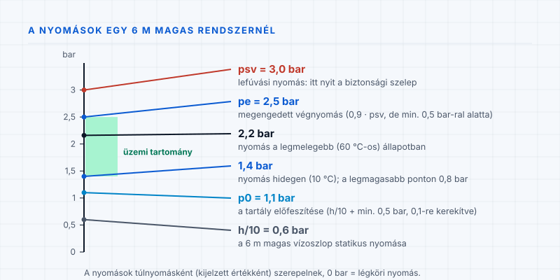

Egy 300 literes fűtési rendszer 10 °C-ról 60 °C-ra melegítve kb. **5 literrel több** helyet kér. Hová menjen ez a víz? Ha nincs tágulási tartály vagy egyéb védelem, a nyomás pillanatok alatt felszalad akár több 100 bárra. Ez szétfesziti a rendszer elemeit, és a leggyengébb alkatrész fog eltörni, kilyukadni.  A tágulási tartály a rendszer „tüdeje”: befogadja a többletet, és visszaadja, amikor a víz lehűl. Nézzük meg, hogyan kell méretezni.

## Hogyan működik?

A membrános tartályban gumi membrán választja el a vizet a gáztértől (nitrogén vagy levegő). Hidegen kevés víz van benne. Melegítéskor a tágulás benyomja a vizet a tartályba, a gáz összenyomódik, a nyomás nő. A kulcs a gáz **előfeszítése**: amíg a rendszer nyomása ez alatt van, a membrán nem mozdul.

*1. ábra – A tartály három állapota: hidegen töltve, üzemi hőmérsékleten és végnyomásnál.*

## A négy nyomás, amit meg kell adni

- **$p_0$, az előfeszítés:** a statikus nyomásnál ($\frac{h}{10}$, ahol $h$ a függöleges távolság, a tartály közepe és a hálózat legmagasabb pontja között méterben) legalább 0,5 bar-ral nagyobb, hogy hidegen a legmagasabb ponton se essen a nyomás 0,5 bar alá. Érdemes 0,1 bar-ra kerekíteni: az 1,1 vagy az 1,8 bar helyszínen könnyen beállítható, az 1,23 bar nehezen.
- **$p_a$, a töltési nyomás:** a töltővíz hőmérsékletétől függ. 
- **$p_{sv}$, a lefúvási nyomás:** a biztonsági szelep nyitónyomása, mindig a leggyengébb elem megengedett nyomásánál 0,5 bárral kisebb.
- **$p_e$, a végnyomás:** fűtésnél a lefúvási nyomás 90%-a, de legalább 0,5 bar-ral alatta (3 bar-os szelepnél 2,5 bar, 6 bar-osnál 5,4 bar). Ivóvíznél a lefúvási nyomás 90%-a. Ennél magasabbra a nyomás nem emelkedhet a legforróbb állapotban.

*2. ábra – A nyomások egy 6 m magas rendszernél (300 l víz, 10–60 °C, 3 bar-os szelep).*

> ► **Gyakori hiba:** a tartályokat gyárilag általában 1,5 bar-ra töltik. Egy 18 m magas háznál ez kevés, a membrán „lefekszik”, a tartály nem dolgozik. A $p_0$ értéket a helyszínen, hideg és leengedett rendszernél kell beállítani.

## Fűtés: mekkora a térfogat?

Három dolgot kell összeadni és a nyomásviszonyokkal korrigálni:

1. **A víz tágulása:** $V_e = V \cdot e$. Az $e$ a víz sűrűségének változásából jön a leghidegebb és a legmelegebb állapot között: $e = \frac{\rho_{\text{hideg}}}{\rho_{\text{meleg}}} - 1$ (10 → 60 °C: kb. 1,7%, 10 → 35 °C: kb. 0,6%). Ezért a rendszer hideg és meleg állapotát is meg kell adni.
2. **Biztonsági tartalék:** a víztartalom 0,5%-a, legalább 3 liter.
3. **Kihasználtság:** a tartály nem tölthető meg teljesen, mert a gáz nyomása nő. Ezt a nyomások aránya adja:

$$
V_{\min} = \frac{(\Sigma V_e + V_{\text{bizt}}) \cdot (p_e + 1)}{p_e - p_0}
$$

**Példa:** 300 literes rendszer, 10 → 60 °C, 6 m magas, $p_{sv} = 3$ bar. $V_e = 5{,}0$ l, $V_{\text{bizt}} = 3$ l, $p_e = 2{,}5$ bar. Az előfeszítés $\frac{h}{10} + 0{,}5 = 1{,}1$ bar. Így $V_{\min} = \frac{8{,}0 \cdot 3{,}5}{1{,}4} \approx \mathbf{20}$ l, vagyis a következő tartályméret, 24 l jön szóba. Ezzel hidegen kb. 1,4 bar a nyomás (a legmagasabb ponton 0,8 bar), 60 °C-on kb. 2,2 bar. Ha 60 °C-os vízzel tölti fel, a töltési nyomás is kb. 2,2 bar lesz, nem 1,4.

## Ivóvíz és használati melegvíz

Itt más a helyzet: a tartály a **hidegvíz-ágba** kerül, és **átáramlásos** kell legyen, hogy a víz mindig cserélődjön (ne pangjon, ne szaporodjon benne a Legionella).

- Előfeszítés: a hálózati nyomásnál 0,2 bar-ral kisebb.
- Végnyomás: $p_e = 0{,}9 \cdot p_{sv}$.
- A tágulás 10 → 70 °C: kb. 2,25%, de a nyomásablak is szűk, ezért a kihasználtság kicsi ($\eta$), és a térfogat: **$V_n = \frac{V_e}{\eta}$**.

**Honnan jön az $\eta$?** Az $\eta$ azt mondja meg, hogy a tartály térfogatának hányad része használható ki a tágulás befogadására a hideg és a végnyomás között. Két részből áll:

$$
\eta = \frac{(p_e + 1) - (p_{\text{hideg}} + 1)}{p_e + 1} \cdot m
$$

ahol a $m$ a maradványtényező, ami azt veszi figyelembe, hogy hidegen a tartálynak már van vize (a feltöltéskor a gáz kissé összenyomódik):

$$
m = 1 - \frac{(p_{\text{hideg}} + 1) - (p_0 + 1)}{p_{\text{hideg}} + 1}
$$

Az első tört a nyomásablak kihasználtságát adja, a $m$ a hidegen töltött víz miatti korrekció. Ebből jön a térfogat: a tágulandó víz ($V_e$) osztva a kihasználtsággal adja a szükséges tartályt.

**Számítása a példával:** $p_{\text{hideg}} = 4{,}5$ bar, $p_e = 4{,}95$ bar, $p_0 = 4{,}3$ bar esetén
$$
\eta_0 = \frac{4{,}95 + 1 - (4{,}5 + 1)}{4{,}95 + 1} \approx 0{,}0756, \qquad m = 1 - \frac{(4{,}5 + 1) - (4{,}3 + 1)}{4{,}5 + 1} \approx 0{,}964
$$
$$
\eta = \eta_0 \cdot m \approx 0{,}073 \qquad V_n = \frac{V_e}{\eta} = \frac{3{,}4}{0{,}073} \approx 46\ \text{l}
$$

**Példa:** 150 literes tároló, 10 → 70 °C, hálózati nyomás 4,5 bar, $p_{sv} = 5{,}5$ bar. $V_e = 3{,}4$ l, $p_0 = 4{,}3$ bar, $\eta \approx 0{,}073$, tehát $V_n \approx \mathbf{46}$ l (50 literes tartály). Ugyanezt egy 8 bar-os szeleppel és 4 bar-os hálózattal 9 literes tartály is elbírja: **a magasabb szelepnyomás kisebb tartályt jelent**.

> ► **Tipp:** ha a számítás szerint nagyon nagy tartály jönne ki, érdemes megnézni, hogy lehet-e nagyobbra állítani a biztonsági szelep nyomását.

## Gyakori hibák

- **Nincs beállítva az előfeszítés.** A tartály nem dolgozik, a szelep csöpög.
- **Túl alacsony a biztonságiszelep nyitónyomása.** A $p_e$ és a $p_0$ közti különbség kicsi, és kétszer-háromszor akkora tartály kell.
- **A tartály a forró ágon van.** A membrán 70 °C körül bírja, fűtésnél a visszatérő ágra, a szivattyú szívóoldalára való.
- **Túl kicsi a tartály.** A biztonságiszelep kinyit, vizet veszít a rendszer, levegő jut be, korrózió indul.

## Számolja ki

A [tágulási tartály méretező](/tagtartaly-meretezo/) a körök és nyomások megadása után kiszámolja a térfogatot, az előfeszítést, a töltési nyomást, a végnyomást és a lefúvási nyomást, majd ajánl is egy tartályt. [Ivóvízhez és HMV-hez itt találja](/tagtartaly-meretezo/?tipus=ivoviz). A gépészeti rendszer egészéről az [Épületgépészeti ABC](/blog/epuletgepeszeti-abc-konyv/) szól, és ha tervezőt keres, [kérjen ajánlatot](/ajanlat/), és 24 órán belül megkapja PDF-ben.
